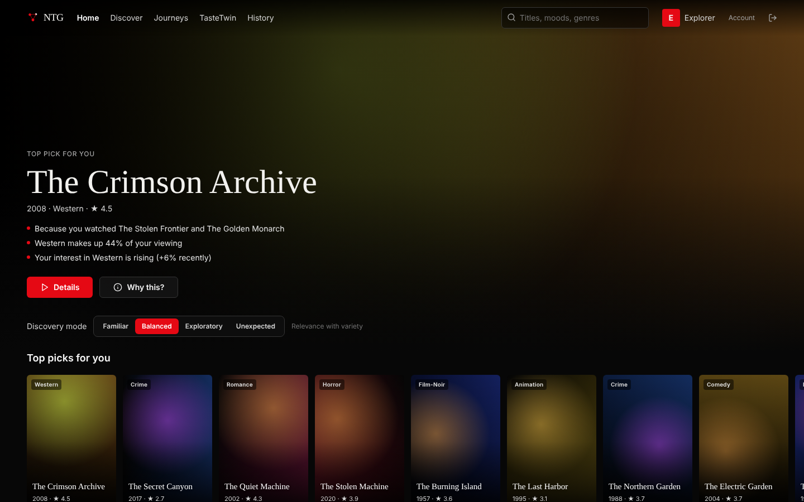

# NTG — Neural Taste Graph

**Entertainment journey intelligence.** NTG models how a viewer's taste *changes*, plans discovery across
sessions instead of re-serving the same list, detects recommendation fatigue, and explains every pick with
evidence taken from the models themselves. It ships as a working product: a Python ML platform, a FastAPI
backend, a consumer app and an enterprise analytics app.

> **Data notice.** The MovieLens 32M download host is blocked in the environment where v4 was built, so
> every result below comes from a **synthetic dataset that uses the MovieLens schema** (generated by
> `ntg.datasets.synthetic`, with known ground truth). The same pipeline runs on the real ML-32M files
> (`make build-ml32m`). Those numbers have not been produced yet. Do not quote the synthetic numbers as
> MovieLens results.



## What is actually built

| Area | What works (tested) | Where |
|---|---|---|
| Data | MovieLens-schema ingest (DuckDB), **global temporal split** with a hard leakage contract, synthetic generator with ground truth | `ntg/datasets` |
| Retrieval | Popularity, ItemKNN, EASE, RP3β graph walk, iALS, NeuMF (NumPy, BPR), content TF-IDF, LSA semantic, sequential Markov | `ntg/recsys/models.py` |
| Ranking | 8-channel candidate union → LightGBM LambdaMART on 38 features (channel scores/ranks, TasteTwin, fatigue, franchise) | `ntg/recsys/hybrid.py` |
| Re-ranking | familiar / balanced / exploratory / unexpected; MMR diversity; franchise and genre caps; relevance floor | `ntg/recsys/rerank.py` |
| Explanations | item-kNN anchors, TasteTwin match, emerging interest, hidden interest, TreeSHAP ranking drivers; no generated text | `ntg/recsys/explain.py` |
| **TasteTwin** | decayed long-term and short-term state with an O(1) online update; momentum, stability, exploration, Beta uncertainty, evolution | `ntg/tastetwin` |
| Intent | NL request → explicit constraints; unsupported asks (runtime, series, language) are surfaced, not ignored | `ntg/intent` |
| Discovery | hidden interests (with evidence), fatigue risk (labelled without using inactivity) | `ntg/discovery` |
| **Journey Orchestrator** | multi-session simulator with explicit assumptions, 6 policies, adaptive fatigue-aware policy, sensitivity sweeps, IPS/SNIPS OPE | `ntg/journey` |
| Enterprise | engagement-risk proxy (out-of-time, calibrated), segments, content intelligence, business scenario simulator, grounded AI analyst | `ntg/enterprise` |
| Platform | FastAPI `/v1`: JWT + scrypt, RBAC, tenant isolation, API keys, rate limit, consent, export/delete, audit, usage | `ntg/api` |
| Apps | Next.js consumer app (12 pages) and enterprise app (15 pages), all wired to the API | `frontend/` |
| Ops | Docker (API and web, both built and run), compose, Alembic, CI, versioned model bundles with SHA-256 manifest | root |

## Headline results (synthetic data, test window starting 2024-04-27)

Hyper-parameters are selected on validation and reported on test. 95% bootstrap CIs. Full detail is in
[docs/EVALUATION_REPORT.md](docs/EVALUATION_REPORT.md).

| Result | Value | Honest reading |
|---|---|---|
| Hybrid LTR, warm users, NDCG@10 | **0.1397** [0.131, 0.149] vs popularity 0.0774 | Ties the best single models (RP3β 0.1388, EASE 0.1379). CIs overlap. |
| Hybrid LTR, cold-start users (1–4 events) | **0.128** vs best single 0.100 (iALS) | Largest gain, but n = 79, so CIs overlap. |
| "Balanced" re-ranking | franchise-duplicate lists 31.8% → **0%**, diversity +19% | Costs 4.8% NDCG. |
| TasteTwin vs static profile (next-period genre mix) | JS divergence −0.0041 [−0.0027, −0.0056] | Small but significant. Gain comes from time decay. |
| Engagement-risk proxy (out-of-time) | AUC 0.80, ECE 0.036 | Recency alone gets 0.79. It is a proxy, not churn. |
| Fatigue model | AUC 0.627 | Does **not** beat its one-signal baseline (0.634). |
| Hidden interests | hit@3 0.59 | Below the popular-genre baseline (0.64). The synthetic drift is random, so nothing personal is learnable. |
| Journey Orchestrator (simulated) | +1.89 satisfaction/journey [1.18, 2.51] vs strong baseline | Holds only when viewers fatigue. At zero fatigue it ties (−0.12 [−0.80, 0.63]). |
| Serving latency (engine, 1 request) | p50 7.4 ms, p95 8.3 ms; with explanations 10.2 ms | Measured on one 4-vCPU container. |

## Quick start

```bash
make install            # poetry + npm
make build              # synthetic data -> tuned models -> reports/v4/synthetic -> artifacts/synthetic (~2.5 min)
make api                # http://127.0.0.1:8000/docs
make web                # http://localhost:3000
```

Local demo accounts are seeded only when `NTG_ENV` is not production: `viewer@demo.ntg`, `analyst@demo.ntg`,
`admin@demo.ntg`, all with password `demo-password-123`.

Docker: `docker compose --profile build run --rm build-models && docker compose up -d api web`.

Real MovieLens 32M: unzip it to `data/external/movielens/ml-32m/`, then run `make build-ml32m`. That uses a
deterministic 10% user sample and items with at least 20 training events, so the dense item-item models fit
in laptop memory.

## Repository map

```
src/ntg/            v4 platform (datasets, recsys, tastetwin, intent, discovery, journey, enterprise, platform, api)
src/ntg/{data,features,graph,models,churn,revenue,experiments}   original v1 pipeline (kept; `ntg legacy`)
frontend/           Next.js consumer + enterprise apps
reports/v4/         evaluation evidence (every documented number comes from these JSON files)
tests/              legacy unit tests + tests/v4 (44 tests; builds a tiny bundle, no download)
migrations/         Alembic
docs/               architecture, model card, evaluation, performance, API, deployment, strategy, interview guide
```

## Documentation

[Architecture](docs/ARCHITECTURE.md) · [Product spec](docs/PRODUCT_SPEC.md) · [Model card](docs/MODEL_CARD.md) ·
[Evaluation](docs/EVALUATION_REPORT.md) · [Performance](docs/PERFORMANCE_REPORT.md) · [API](docs/API_REFERENCE.md) ·
[Security](SECURITY.md) · [Deployment](docs/DEPLOYMENT.md) · [Contributing](CONTRIBUTING.md) ·
[Startup strategy](docs/STARTUP_STRATEGY.md) · [Interview guide](docs/INTERVIEW_GUIDE.md) · [Roadmap](ROADMAP.md) ·
[Progress log](PROGRESS.md)

The technical invention dossier is deliberately **not** in this public repository (see ROADMAP.md, "IP").

NTG is an independent project. It is not affiliated with or endorsed by any streaming service, and it uses no
third-party branding or artwork. Poster art is generated procedurally.
