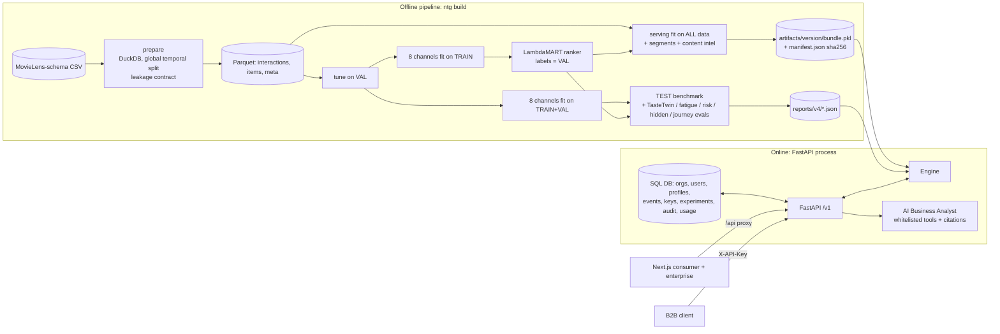
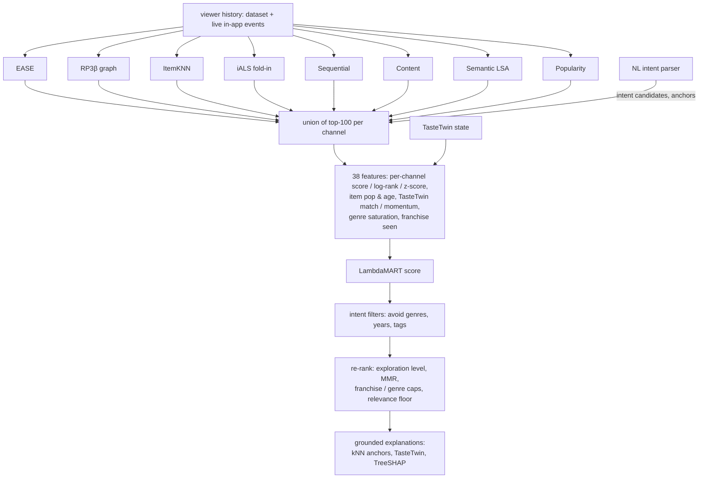
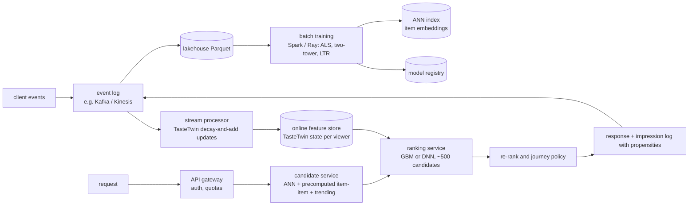

# Architecture

This document describes **what is implemented** (§1–5) and, separately, the **scale-out design**
(§6), which is not implemented or tested.

## 1. System overview (implemented)

## 2. Data layer

* `ntg.datasets.prepare`: DuckDB reads `ratings.csv` (it streams 32M rows), with an optional hash sample
  of users. Item-support and user-activity filters are computed **on the training window only**. Two global
  timestamp cut-offs define train, val and test, and `max(train.ts) < min(val.ts) ≤ max(val.ts) < min(test.ts)`
  is asserted in code. Tags are restricted to the training window.
* `ntg.datasets.matrix.InteractionData`: contiguous indices, CSR builders, genre multi-hot matrix, and a
  heuristic franchise key. It defines the windows `val` (fit = train), `test` (fit = train+val) and
  `full` (serving).
* `ntg.datasets.synthetic`: a MovieLens-schema generator with ground truth (see EVALUATION_REPORT §0).

## 3. Recommendation stack

Key design decisions:

* **Every channel scores an arbitrary history** (`score_history`). That makes brand-new viewers and live
  in-app events first-class with no retraining. A test asserts that online scores and features equal the
  batch ones.
* **Two-stage training without leakage:** the ranker learns from VAL labels using channels fit on TRAIN,
  then runs frozen on channels refit with more data.
* **Exploration is a re-ranking concern**, so the relevance model stays clean and the accuracy-versus-
  discovery trade-off is measured explicitly (EVALUATION_REPORT §4).

## 4. Intelligence modules

| Module | Core idea | State / complexity |
|---|---|---|
| TasteTwin | decayed sufficient statistics `S(t) = S(t₀)·2^(−Δt/h) + w·g_item` for two half-lives; shares, momentum, stability, Beta posterior uncertainty | O(genres) per viewer; O(1) per event |
| Intent | lexicon and regex parser into explicit / unsupported; inferred preferences added by the engine and labelled | stateless |
| Hidden interests | (collaborative genre mass + global prior) − own share, restricted to genres under 5% of the viewer's history; evidence returned | per request |
| Fatigue | standardised logistic regression on concentration, repetition, rating trend, novelty and gap signals; label = rating drop among viewers who stay active | per viewer |
| Engagement risk | calibrated GBM on activity and fatigue features; label = 90 days with no activity; out-of-time | per viewer |
| Journey Orchestrator | per-viewer Beta beliefs about fatigue (accept rate on saturated vs fresh genres) scale the fatigue penalty, diversity and UCB exploration; hard no-re-show window | per session |
| Simulator / OPE | an oracle world (EASE + RP3β on all data) plus explicit fatigue, repetition and leaving dynamics; IPS / SNIPS checked against the true value | offline |
| Analyst | topic router → whitelisted fact tools over reports and aggregates → cited answer; injection, competitor and PII guards | per question |

## 5. Platform

* **API:** FastAPI with synchronous endpoints, so engine calls run in the threadpool. The engine is
  loaded once per worker. Startup replays stored events into the engine and computes population
  aggregates.
* **Persistence:** SQLAlchemy 2.0 with SQLite in development (WAL) and PostgreSQL through
  `NTG_DATABASE_URL`, with `psycopg` in the optional `postgres` group. Alembic manages migrations. Every
  tenant row carries `org_id`. Deleting a user cascades.
* **Security:** see SECURITY.md (scrypt, JWT, hashed API keys, RBAC, rate limit, security headers,
  consent, export/delete, audit).
* **Artifacts:** `artifacts/<dataset>/<version>/{bundle.pkl, manifest.json}` plus a `CURRENT` pointer.
  The manifest includes the git SHA, data meta, hyper-parameters, test metrics and the bundle SHA-256,
  which is verified before unpickling.
* **Observability:** structured JSON logs with secret scrubbing, a request ID, and per-request latency.
  `/v1/enterprise/monitoring` reports latency percentiles, error rate, model age, drift PSI and live-event
  counts.
* **Frontend:** Next.js 14 app router with client components calling `/api/*`, which is rewritten to the
  API at build time. Dark design tokens; charts use a CVD-validated categorical palette.
* **Deliberately not used:** Kafka, Kubernetes, Redis, a vector database. Nothing in the current workload
  needs them. The catalogue fits in memory, and exact dense scoring over 3k items takes milliseconds.

## 6. Scale-out design (NOT implemented; design targets, not claims)

Targets: 100M viewers, 10M titles, real-time updates, multi-region.

What changes and why:

1. **Candidate generation.** Dense O(I²) EASE does not scale to 10M titles. Replace it with two-tower or
   ALS embeddings served from an ANN index (HNSW / ScaNN), with sparse item-item neighbours precomputed
   offline (top-k per item, the v1 DuckDB co-occurrence job generalised and sharded).
2. **TasteTwin.** The decayed sufficient statistics are already designed for streaming. State is two
   19-genre vectors plus a few scalars (about 40 float32 values, ~160 B) per viewer, roughly 16 GB per
   100M viewers, which fits an online KV store. Updates are
   commutative after decay, so they are idempotent under at-least-once delivery if keyed by event ID.
3. **Ranking.** Feature computation moves to the feature store. Ranking cost scales with candidates
   (about 500 per request), not with the catalogue size.
4. **Journey policy.** Per-viewer Beta beliefs live alongside TasteTwin state. Impressions are logged with
   propensities so IPS / SNIPS can evaluate new policies offline before an A/B test.
5. **Multi-region.** Stateless serving tiers per region, region-local feature stores replicated
   asynchronously, and model artifacts distributed through the registry. Viewer state is homed in a
   region for data-residency compliance.
6. **Latency budget** (target, unmeasured): gateway 5 ms, candidates 15 ms, features 10 ms, ranking 20 ms,
   re-ranking 5 ms, which gives p99 under 100 ms.

None of §6 has been built or load-tested. The only measured numbers are in PERFORMANCE_REPORT.md.
